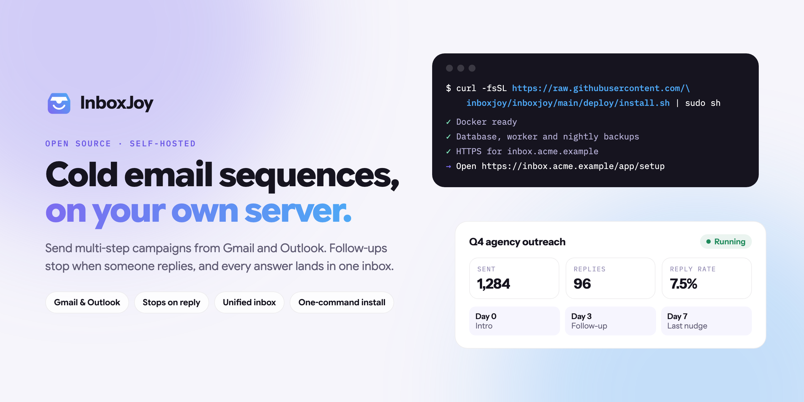
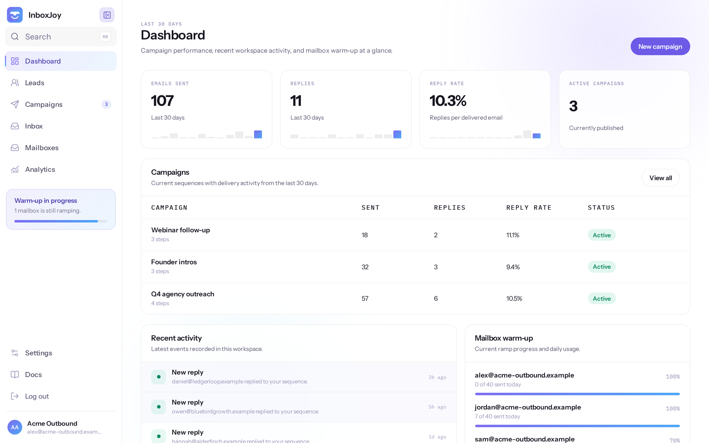
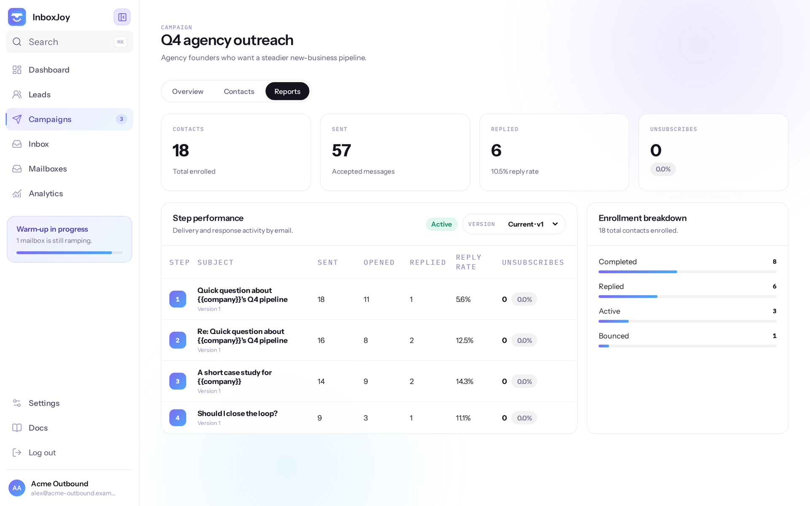
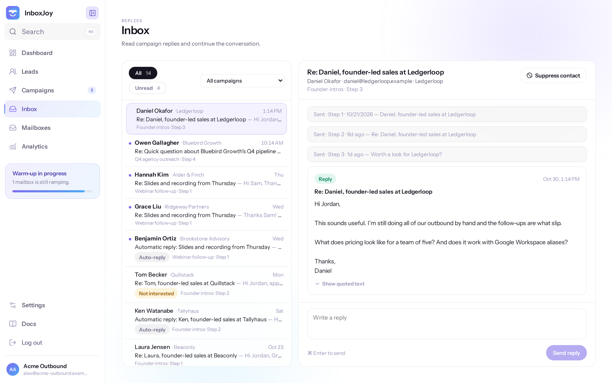
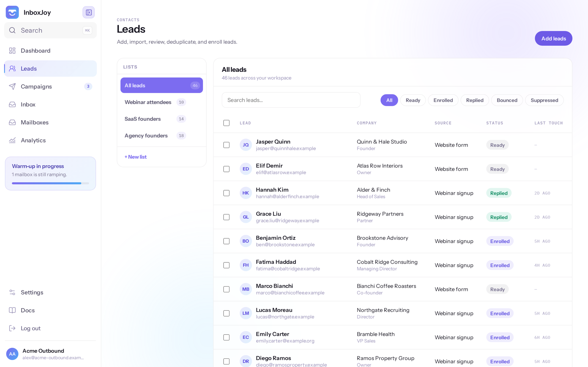
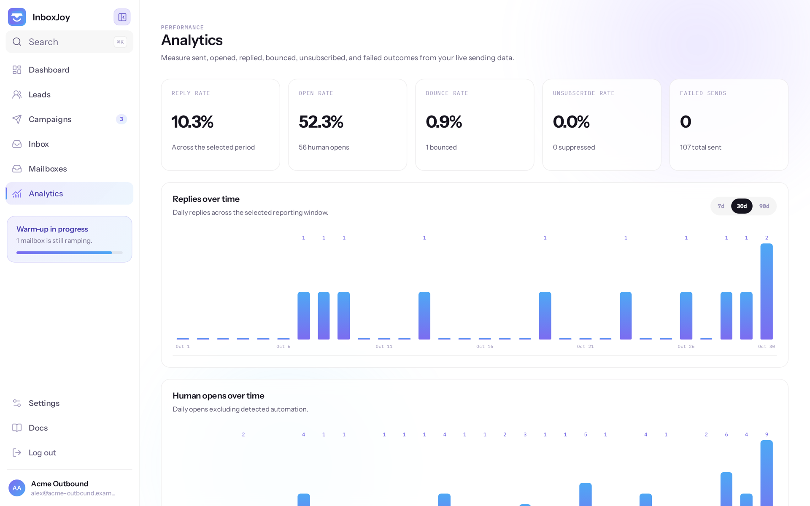

<p align="center">
  
</p>

<p align="center">
  <a href="https://inboxjoy.online">Website</a> ·
  <a href="docs/self-hosting/README.md">Self-hosting guide</a> ·
  <a href="https://github.com/inboxjoy/inboxjoy/discussions">Discussions</a> ·
  <a href="https://github.com/inboxjoy/inboxjoy/releases">Releases</a> ·
  <a href="LICENSE">AGPL-3.0</a>
</p>

# InboxJoy

Open-source cold email sequencing for Gmail, Outlook and any SMTP mailbox.
Write multi-step campaigns, send them from your own mailboxes, stop follow-ups
the moment someone replies, and answer everyone from one inbox. Run it free on
your own server, or let us run it for you.

## Features

- **Your own mailboxes.** Gmail, Google Workspace, Outlook or any SMTP/IMAP
  provider. Spread sending across several mailboxes, each with its own daily
  limit.
- **Multi-step sequences.** Steps with delays, personalised with lead fields
  and per-campaign variables.
- **Stops on reply.** A lead who answers gets no more follow-ups.
- **One inbox for every reply.** Read and answer replies from all mailboxes in
  one place.
- **Leads and lists.** CSV import, lists whose new leads join running
  campaigns automatically, suppressions and unsubscribes.
- **Analytics.** Sends, opens, replies and reply rates for each campaign.
- **AI drafts.** Write and refine steps with any OpenAI-compatible model
  (optional).
- **API and MCP.** Drive campaigns from scripts, Claude or ChatGPT.
- **Teams.** Workspaces, invitations and roles.

## Screenshots

<p align="center">
  
</p>

<table>
  <tr>
    <td width="50%"><br><sub><b>Campaigns:</b> step-by-step results for every sequence.</sub></td>
    <td width="50%"><br><sub><b>Inbox:</b> every reply in one place, with the thread that led to it.</sub></td>
  </tr>
  <tr>
    <td width="50%"><br><sub><b>Leads:</b> lists, import, status and last touch at a glance.</sub></td>
    <td width="50%"><br><sub><b>Analytics:</b> replies, opens and bounces over time.</sub></td>
  </tr>
</table>

<sub>Screenshots use made-up demo data.</sub>

## Deploy anywhere

InboxJoy runs on **any Linux server with 2 GB of memory**. One command installs
Docker if needed, the database, HTTPS certificates and nightly backups:

```bash
curl -fsSL https://raw.githubusercontent.com/inboxjoy/inboxjoy/main/deploy/install.sh | sudo sh
```

| Where | Examples |
| --- | --- |
| Cloud VPS | Hetzner, DigitalOcean, Vultr, Linode, OVHcloud, Scaleway |
| Big clouds | AWS (Lightsail or EC2), Microsoft Azure, Google Cloud, Oracle Cloud |
| Your own hardware | A home server or mini PC, or an ARM board such as a Raspberry Pi 5 (64-bit OS) |

**You need:** 2 GB of memory, 2 CPU cores, 10 GB of disk, a domain name pointed
at the server, and ports 80 and 443 open. Intel/AMD and ARM are both supported.
Ubuntu 22.04/24.04 and Debian 12 are the tested systems.

Then follow [the self-hosting guide](docs/self-hosting/README.md): first
sign-in, [connecting mailboxes](docs/self-hosting/mailboxes.md),
[system email](docs/self-hosting/system-email.md), [AI](docs/self-hosting/ai.md),
[backups](docs/self-hosting/backups.md) and
[upgrades](docs/self-hosting/upgrading.md).

## Self-hosted or managed

Both are the same code.

| | Self-hosted | Managed |
| --- | --- | --- |
| Price | Free | $79 once, lifetime licence |
| Who runs it | You, on your server | Us |
| Gmail and Outlook | App passwords (SMTP/IMAP), or one-click with your own Composio account | One-click connect |
| AI drafts | Bring any OpenAI-compatible key | Included |
| Updates and backups | `inboxjoy upgrade` and built-in nightly backups | Done for you |

Managed InboxJoy: [inboxjoy.online](https://inboxjoy.online).

## Local development

Requirements: Node.js 22+, pnpm 11+, and PostgreSQL 16+.

```bash
cp .env.example .env
pnpm install
createdb inboxjoy
pnpm db:migrate
pnpm dev
```

Open http://localhost:3000. The API runs on http://localhost:4000 and the worker health endpoint on http://localhost:4001.

If PostgreSQL is not installed locally, use `docker compose up -d postgres`.

### Commands

```bash
pnpm dev
pnpm typecheck
pnpm test
pnpm build
pnpm db:generate
pnpm db:migrate
```

## Contributing

Issues, ideas and pull requests are welcome. Read [CONTRIBUTING.md](CONTRIBUTING.md)
first; pull requests need a one-time contributor agreement. Report security
issues privately as described in [SECURITY.md](SECURITY.md).

## License

InboxJoy is licensed under [AGPL-3.0](LICENSE). The InboxJoy name and logo are
trademarks; see [TRADEMARK.md](TRADEMARK.md) before shipping a fork under them.

## Documentation

- [Documentation index](docs/README.md)
- [Current architecture](architecture.md)
- [Regression guardrails](docs/regression-guardrails.md)
- [Campaign regression matrix](docs/campaign-regression-matrix.md)
- [Safe feature plan (proposed)](docs/feature-plan.md)

- [API reference](docs/api.md)
- [Data model](docs/data-model.md)
- [Developer guide](docs/development.md)

Architecture and guardrails track verified behavior. The original specification
is historical; the feature plan and backlog describe proposed work. Known gaps
are called out explicitly instead of being presented as shipped features.
