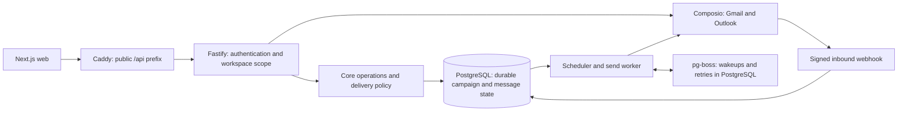
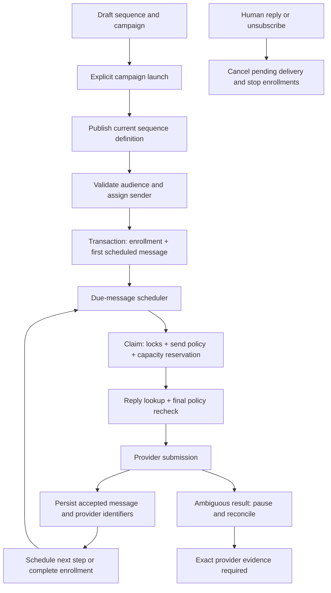

# InboxJoy architecture

Verified against `main` at `5a2b589` on 2026-10-03. This describes implemented behavior; [the feature plan](docs/feature-plan.md) describes proposed work. Recheck the referenced code whenever a contract changes.

## Start here

- Read this map and [regression guardrails](docs/regression-guardrails.md) before changing a campaign dependency.
- Use the [regression matrix](docs/campaign-regression-matrix.md) to select tests.
- Follow [DESIGN.md](DESIGN.md) for UI changes.

## Runtime and ownership

The direct API-to-provider path is for manual Inbox replies and mailbox integration. Campaign messages go through the worker. Azure transactional email handles auth/system email and sequence test messages; a test send does not prove connected-mailbox delivery.

| Boundary | Source of truth | Responsibility |
|---|---|---|
| Product UI | `apps/web/app/app/(product)/` | Campaign editor, audience picker, Inbox, mailbox and billing screens |
| REST and authentication | `apps/api/src/app.ts`, `apps/api/src/auth.ts`, `apps/api/src/server.ts` | Session/API-key access, authorized workspace, input boundaries and route adapters |
| Business operations | `packages/core/src/index.ts`, `sending-analytics.ts`, `mcp-ops.ts` | REST/MCP shared operations, enrollment, lifecycle, billing and manual replies |
| Delivery decisions | `packages/core/src/delivery/can-send.ts` | Canonical sending entitlement, safety and pacing rules |
| Durable storage | `packages/db/src/schema.ts`, `packages/db/migrations/` | Versioned sequences, campaign audiences, enrollments, messages, attempts and events |
| Queue transport | `packages/queue/src/jobs.ts`, `client.ts` | Validated job payloads, singleton dispatch and bounded job retries |
| Worker runtime | `apps/worker/src/worker.ts`, `apps/worker/src/jobs/` | Scheduling, claims, provider sends, recovery, health and lifecycle sweep |
| Provider integration | `packages/composio/src/index.ts`, `packages/smtp/src/client.ts`, `packages/email/src/campaign-mime.ts` | Server-managed Gmail/Outlook delivery and credential-backed SMTP delivery with shared campaign MIME |

PostgreSQL owns message content and delivery state. A queue job carries identifiers and an idempotency key, not a second copy of the campaign or email. Provider credentials stay server-side.

### Editions

One codebase builds two products, chosen by `INBOXJOY_EDITION`. `cloud` is the managed service: campaign sends need the $79 lifetime license, a comp, or a legacy Free window (`workspaces.legacy_free_until`), and everything else waits with `payment_required`. `selfhost` is the open-source edition: every workspace is entitled and billing operations refuse with `not_available`. Production must set the variable (API and worker refuse to boot without it); dev and test default to `selfhost`. The API passes it to core as `OperationContext.env.edition`, the worker reads its own env, and the single plan rule is `sendingPlan()` in `can-send.ts`. Outbound Message-IDs use `messages.inboxjoy.online` in cloud and the sending mailbox's domain in self-host; reply matching compares whole stored Message-IDs and senders, never that domain.

## Campaign pipeline

1. The API authenticates the caller and passes the authorized workspace into an operation. `runOperation` parses inputs; operation access metadata alone does not authorize a caller. New routes must use the existing authentication/scope and permission checks.
2. `campaigns.launch` in `sending-analytics.ts` requires manager access and a verified owner, publishes/resumes the sequence as needed, resolves the campaign audience and calls enrollment.
3. `enrollSequence` in `index.ts` validates workspace, sequence, lists and senders; `enrollment-eligibility.ts` selects distinct eligible contacts. The transaction locks and rechecks campaign/sequence state and eligibility, creates enrollment plus first message, and may restart a completed campaign after adding leads.
4. `schedule-due-messages.ts` reads due durable rows and enqueues a singleton job using the message idempotency key. It checks `canSend()` and campaign state. The recurring scheduler runs every two minutes; this is not a delivery-time guarantee.
5. `send-message.ts` claims with row/advisory locks, reserves capacity, records the attempt and a claim lease, checks for replies, and rechecks policy after provider lookup before submitting.
6. Acceptance is stored before follow-up advancement. Retries recover missing acceptance bookkeeping without resending an accepted email.
7. Definite transient rejections use bounded backoff. Ambiguous submission results pause the enrollment; `reconcile-inbox.ts` uses provider evidence and does not blindly resend.

Mail already submitted to a provider cannot be recalled. "Accepted" means provider acceptance, not proof of Inbox placement.

### Other entry points with delivery effects

| Entry point | Implemented behavior |
|---|---|
| `sequences.publish` | Activates the definition; publishing alone does not perform campaign launch |
| `sequences.launch` / `sequences.enroll` | Sequence-level paths; they are not interchangeable with `campaigns.launch`. Direct enrollment resolves campaign association under existing rules. On a draft sequence, `sequences.enroll` instead writes to the `staged_enrollments` table (nothing scheduled); `sequences.publish` converts queued rows into real enrollments through `enrollSequence` itself, so suppression/eligibility/caps/warm-up apply identically, then clears the queue. Archiving or deleting a draft discards its queue |
| Add a list member / import into a list | Calls `enrollNewListLeads`; newly added eligible contacts can start sending in active campaigns or restart completed campaigns |
| Paused campaign list additions | Lead addition succeeds but campaign enrollment is blocked and reported; the lead waits |
| Draft or archived campaign list additions | No automatic enrollment into those campaigns |
| `replies.send` | Direct human response with its own reservation/idempotency event; does not restart a sequence. Shares safety/entitlement/volume rules through manual-reply policy |
| Audience preview, campaign list/detail | Read projections; no enrollment or lifecycle reconciliation |

Import/list additions are therefore campaign-affecting changes even if no launch button is clicked. Auto-enrollment errors are reported as campaign updates; successfully saving leads is not proof that they were enrolled.

## State and identity contracts

### Session workspace selection and invitations

Session-authenticated `/v1/` requests use `users.active_workspace_id` only when
it matches an active membership. Null or stale preferences fall back to the
most recently joined active membership, preserving existing-user behavior.
`apps/api/src/app.ts` shares one membership query between normal resolution and
the recovered-membership self-heal path. API keys and MCP OAuth tokens retain
their pinned workspace; consent continues to pick a workspace explicitly.

`workspaces.list` and `workspaces.switch` in `packages/core/src/index.ts` power
`GET /v1/workspaces` and `POST /v1/workspaces/switch`. Both routes require a
browser session, and both operations are denied as MCP tools. Switching checks
active membership without leaking workspace existence and persists the user's
preference. Invitation acceptance sets the same preference in its transaction.

Workspace owners can have 20 unaccepted, unexpired invitations. Invitation
creation locks the workspace to serialize cap checks and still replaces a
pending invitation to the same email at the cap. The REST invitation endpoint
allows ten requests per minute. After commit, optional transactional email sends
the invitation link; missing configuration or delivery failure leaves the
invitation usable and returns `emailSent: false`. See
[workspace switching rollout](docs/workspace-switching.md) for migration,
resolver audit, and validation requirements.

### Delivery identity

| Object | Contract to preserve |
|---|---|
| Campaign | Stored states: `draft`, `active`, `paused`, `completed`, `archived`. `completed` displays as `finished`; `needs_attention` is a display projection, not a persisted state |
| Auto-finish | Only launched active campaigns with no scheduled/active/paused enrollments finish. Paused enrollments still count as unfinished |
| Restart | Enrollment may restart a completed campaign when it actually adds eligible leads. The five-minute status sweep only finishes campaigns and stays quiet |
| Archive/pause | Campaign controls are scoped to the campaign. Sequence controls affect its enrollments across campaigns; concurrency must preserve pause/archive |
| Audience | Selected lists form a distinct union. Suppression, contact state, sequence enrollment and campaign history determine eligibility; a new version never authorizes resending old campaign contacts |
| List deletion | Last audience removal is blocked for draft/active/paused campaigns whose sequence is not archived. One of several lists can be removed; the legacy primary list is repaired. Completed/archived campaigns may lose their last list, but a completed campaign then requires a list to relaunch |
| Version | Sent messages retain their version and step references. Draft edits replace draft steps; paused edits create a draft version. On resume, each resumed lead's next unsent email is re-rendered from the same-numbered step of the current version and the lead moves to it (it stays put when that step is missing or a variable has no value). Active sequence content edits require no in-progress enrollments across that sequence, then create a new active version |
| Resume timing | Pausing never pushes email later. On resume a follow-up is due its step's wait after the previous email was accepted (plus the deterministic follow-up jitter), so one that came due while paused sends right away under the normal gates; first emails keep their scheduled time |
| Sender | Explicit enrollment selection overrides saved sequence selection; campaign launch/auto-enrollment supplies the campaign's sender. An empty saved sequence selection retains rotation across sendable workspace mailboxes |
| Sender reassignment | Only eligible contacts waiting for their first send move. Sent/in-flight/uncertain messages and existing conversation senders remain pinned; mailbox changes are not a bulk rewrite of delivery history |
| Idempotency | Durable message key `${enrollmentId}:${stepOrder}`, attempt state, claim locks and provider evidence jointly prevent duplicate sends. Queue retry alone is insufficient |

Canonical lifecycle helpers: `packages/core/src/campaign-status.ts`, `enroll-new-list-leads.ts`, `enrollment-eligibility.ts`, `sequence-mailboxes.ts`, and the enrollment/sequence-edit paths in `index.ts` and `apps/api/src/app.ts`.

## Inbound events, suppression and recovery

- `apps/api/src/modules/webhooks/index.ts` verifies signatures and deduplicates provider events. For matching workspace contacts with in-progress enrollments on that mailbox, human replies stop follow-ups and automatic replies are captured without stopping. Opt-outs, complaints and permanent bounces apply workspace suppression; temporary provider/bounce warnings do not suppress contacts.
- The follow-up provider lookup also persists missed replies and reply events before stopping. Temporary reply-write failures retry before submission.
- `reconcile-inbox.ts` recovers uncertain submissions and accepted-message bookkeeping. Reply backfill is a separate worker job and CLI enqueue path, not a promise that every inbound message is continuously polled.
- SMTP campaign and manual-reply clients are cached per mailbox by `packages/smtp/src/mail-client-resolver.ts`. Successful SMTP submissions retain the pinned RFC Message-ID; appending their MIME to IMAP Sent is best-effort. Sent-folder reconciliation reports a missing message only after a successful search and an attempt older than ten minutes. A cached client is rebuilt when the mailbox's `verified_at` or `key_version` changes, and an expired or replaced client closes only after its in-flight sends and lookups settle. SMTP inbound replies and bounces are ingested by `apps/worker/src/jobs/poll-imap.ts`, which polls each mailbox's INBOX by UID cursor through the shared `packages/core/src/inbound` pipeline.
- Manual `manual_reply_pending` / `manual_reply_sent` events count against shared capacity. Ambiguous manual sends retain the reservation and reject the same request on retry; inspect the provider conversation before any retry. There is no automated manual-pending resolution path today. Definite provider rejection releases the reservation.
- Queue registration, scheduler cadence, webhook shapes and provider identifiers are compatibility boundaries. See the regression matrix before changing them.

## Safe extension boundary

The first delivery-advisor stage will be a read-only projection over existing state. It can reuse campaign display/eligibility projections and canonical pure policy helpers, but must not invoke enrollment, reconciliation, provider sending, capacity/probe reservation or lifecycle writes.

Read-only describes business/delivery state. Existing API-key access bookkeeping
can still update `api_keys.last_used_at` during authentication.

New metadata and read endpoints should be additive. New features must fail independently and have a disable path that preserves the existing campaign flow. Advisory DNS health must not become a new sending gate in the first stage.

## Environment and verification

Development runs in an isolated stack beside production. Test PostgreSQL is separate; never point regression fixtures at production.

Schema changes require new reviewed migrations, compatible with the previous release. Application rollback does not undo migrations. For docs-only changes, verify documentation links/source references and the baseline checks; do not rebuild or deploy live services just to publish documentation.
